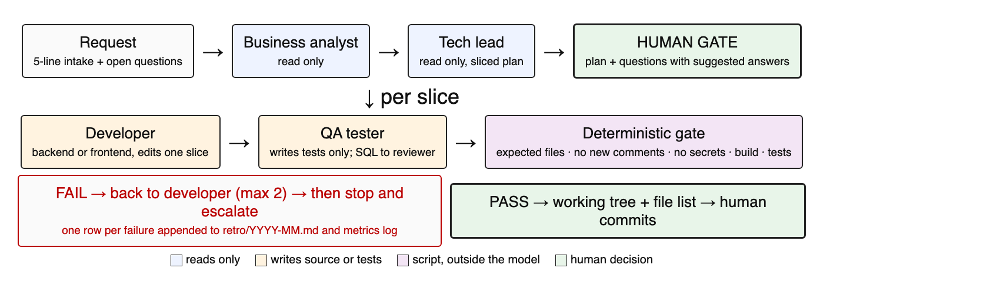

# agentic-delivery-harness

A small harness that lets AI coding agents deliver changes to real systems while a deterministic gate and a human keep control.

## Why

AI agents now edit code in legacy systems where a wrong file, a stray comment or a leaked credential has a real cost. The model that wrote the change cannot also be the judge of whether it is safe to ship. So the agents plan and write, a plain script checks, and a human approves and commits.

## How it works



1. Roles with write boundaries. Six role files in `agents/`: `business-analyst`, `tech-lead` and `ux-reviewer` are read-only; `backend-dev` and `frontend-dev` edit only the approved slice in the confirmed repo; `qa-tester` writes only inside the test folder. No role commits, pushes or edits local config.
2. Human gate before implementation. The plan is shown in slices, with every open question and a suggested answer, and nothing is implemented until the owner says OK.
3. Deterministic gate outside the model. `scripts/gate.py` is plain Python with no model call and no dependencies. It runs after each slice and appends one line per run to a JSONL log.
4. Retro loop with human-approved rules. Each gate FAIL appends a row to the month's retro file. A suggested rule becomes a rule in an agent or in the global instructions only after the owner approves it.

The step-by-step flow is in [docs/flow.md](docs/flow.md).

## Quick start

Requires Python 3.9+ and git. The agent files use the Claude Code sub-agent format.

```
mkdir -p ~/.claude/scripts ~/.claude/agents
cp scripts/*.py ~/.claude/scripts/
cp agents/*.md ~/.claude/agents/
```

Run the gate on a repository after a slice is done:

```
python3 -I ~/.claude/scripts/gate.py --repo ~/code/my-service --slice F1 \
  --expected examples/expected-files.txt \
  --build "dotnet build" --test "dotnet test"
```

Exit code is 0 when every check passes and 1 when any check fails. Runs go to `~/.claude/metrics/slices.jsonl` and failures to `~/.claude/retro/YYYY-MM.md`, unless `--metrics` and `--retro-dir` point elsewhere. See [examples/](examples/README.md).

Summarize the log:

```
python3 -I ~/.claude/scripts/metrics.py
```

## What the gate checks

1. files: `git status` against the list of expected files. Any changed file outside the list fails.
2. comments: new comments in added lines of code (`.cs .ts .tsx .js .jsx .py .sql .css`, and `<!--` in HTML).
3. secrets: possible secrets in added lines, reported as file:line and type. The value is never printed. Template files and obvious placeholders are skipped.
4. build and test: only the commands passed with `--build` and `--test`. The gate never guesses a command.

## Real numbers

From the harness running on real work between 2026-10-15 and 2026-11-01:

1. 33 gate runs over 22 slices in 4 repositories.
2. First-pass rate: 10 of 22 slices (45%) passed on their first gate run.
3. Top FAIL reasons: secrets (14), comments (11), files (10).

The anonymized log and the per-slice table are in [metrics/README.md](metrics/README.md). These are numbers from one practitioner, not a benchmark.

## Repository layout

```
agents/              six role files (English)
  pt-BR/             Portuguese originals
scripts/
  gate.py            deterministic gate for one slice
  metrics.py         summary of the gate log
  harness-lint.py    lint for CLAUDE.md files and memory
metrics/
  slices.jsonl       anonymized gate runs
  README.md          summary and per-slice table
retro/               monthly retro tables and the loop description
docs/
  flow.md            end-to-end flow
  sql-guardrail.md   format for state-changing SQL
  figures/flow.png   delivery flow diagram
examples/            expected-files list and a sample gate command
```

## SQL guardrail

Agents may write SQL but never run it. A script that changes state in production prints the server and database at the top, takes a baseline, simulates the change as a SELECT, keeps the write behind a switch that is off by default, carries its own rollback block and repeats the baseline at the end. It always goes through a SQL reviewer, and diagnosis in production is sampled and read-uncommitted, never a full scan. Details and a T-SQL skeleton are in [docs/sql-guardrail.md](docs/sql-guardrail.md).

## Status and limits

1. Version 0.1. Built and used by a single practitioner; expect rough edges.
2. Agent files are in the Claude Code sub-agent format. Other agent runtimes need their own wrapper.
3. Paths default to `~/.claude/...`. Adapt paths, role boundaries and rules to your own setup.
4. `harness-lint.py` assumes a specific layout of projects and memory folders and is included as a reference.

## Citation

If you use this work, please cite it using [CITATION.cff](CITATION.cff). A paper describing the harness is under submission.

## License

MIT, see [LICENSE](LICENSE).

Author: Kleber Tomazi, KLT Development Ltda.
