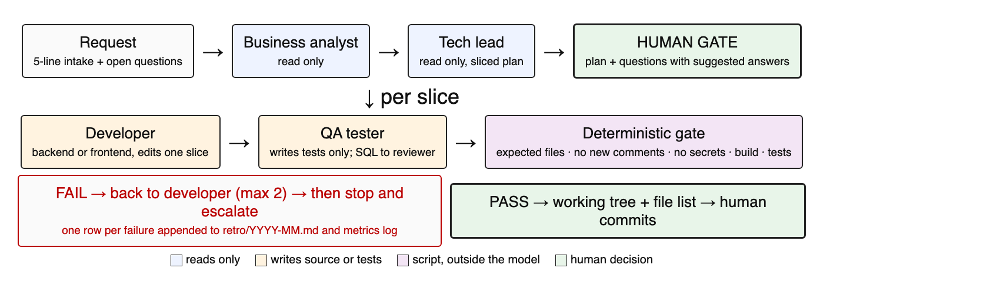

# Flow: a development request without a command

When the repository owner asks for something that changes code (feature, bug, adjustment, migration), the main session follows this flow on its own, without anyone typing a command:

1. Intake: summarize the request in 5 lines and list the open questions. If the product has a domain skill, load it.
2. Call `business-analyst`, then `tech-lead` (both in `~/.claude/agents/`), one at a time. If the plan touches the database, a screen or a reply to a customer, call `sql-reviewer`, `ux-reviewer` or `ticket-reviewer` when they exist.
3. GATE: show the plan in slices and the consolidated questions (intake + analyst + tech lead), each with a suggested answer, and stop. Continue only with the owner's OK.
4. After the OK: developers in `backend-dev`/`frontend-dev`, one per slice, then `qa-tester`, then the gate `~/.claude/scripts/gate.py` with the list of expected files. A FAIL goes back to the slice's developer, with at most two retries; after that, stop and escalate. Every relevant rejection goes to `~/.claude/retro/YYYY-MM.md`.
5. Final report: changed files and the list for the owner to commit. Never commits, never pushes. Refreshes the task's HANDOFF with the current state.

Questions and explanations do not enter the flow: they are just answered.

The six role files in `agents/` are English translations. The Portuguese originals, the versions used day to day, are in `agents/pt-BR/` under their original names (`analista-negocio`, `tech-lead`, `dev-backend`, `dev-frontend`, `ux-ui`, `qa-tester`). `sql-reviewer` and `ticket-reviewer` are project-specific and not included.
